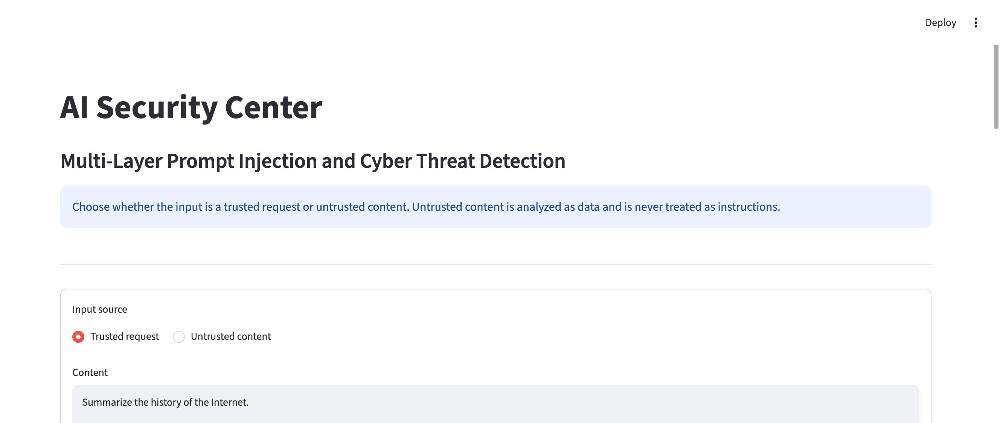

# AI Security Threat Detection and Defense System

A local Streamlit prototype that screens user requests and external content for prompt-injection and cyber-threat indicators. It combines regular-expression rules, a TF-IDF/logistic-regression classifier, and a separate rule-based threat analyzer. Optional OpenAI, Anthropic Claude, Azure OpenAI, and Azure Foundry integrations generate responses only through the security gateway.



For vulnerability reporting, see [SECURITY.md](SECURITY.md). For setup and contribution guidance, see [CONTRIBUTING.md](CONTRIBUTING.md).

## Security Features

- Multi-layer prompt-injection detection using rules and a locally trained classifier, plus explicit cyber-threat analysis.
- Explicit trusted-request and untrusted-content modes; untrusted text is kept separate and treated as data, not instructions.
- Gateway enforcement that blocks suspicious trusted requests and quarantines suspicious untrusted content before provider calls.
- Input screening for common PII and secret patterns, including email addresses, phone numbers, SSNs, payment cards, API tokens, credential assignments, and private-key blocks. Detected input is blocked before it reaches a provider.
- Output screening that redacts detected PII and secrets before display.
- Random synthetic canaries scoped to each Streamlit session; responses containing a canary are withheld. The app does not keep conversation history or store canaries globally.
- Provider safeguards including deny-by-default tools, source-labeled inputs, no automatic provider fallback, and fail-closed handling when analysis is unavailable.
- Privacy-aware logging that records decisions and exception types without submitted prompt text.

Detection patterns are heuristic and incomplete. Passing screening does not prove content is safe, and provider-side retention policies still apply.

## Run Locally

Use Python 3.13 through 3.15.2. The CI matrix covers Python 3.13, 3.14, and 3.15.2; local validation has been run on 3.15.2. Install the pinned runtime and test dependencies:

```bash
python -m pip install -r requirements.txt
```

To enable OpenAI responses, set `OPENAI_API_KEY` in the process environment before launching Streamlit. The default model is `gpt-5.5`; set `OPENAI_MODEL` to select another model available to your account. Keep keys out of source files and version control. Without provider credentials, the app performs security analysis only and does not send requests.

Select a provider with `MODEL_PROVIDER` (defaults to `openai`). Configuration is read from the process environment, never from submitted text:

| MODEL_PROVIDER | Required Settings | API |
| --- | --- | --- |
| `openai` | `OPENAI_API_KEY`; optional `OPENAI_MODEL` | Responses |
| `anthropic` (or `claude`) | `ANTHROPIC_API_KEY`, `ANTHROPIC_MODEL` | Claude Messages |
| `azure_openai` | `AZURE_OPENAI_API_KEY`, `AZURE_OPENAI_ENDPOINT`, `AZURE_OPENAI_DEPLOYMENT` | Azure v1 Responses |
| `azure_foundry` | `AZURE_FOUNDRY_API_KEY`, `AZURE_FOUNDRY_ENDPOINT`, `AZURE_FOUNDRY_MODEL` | Azure v1 Chat Completions |

To use Claude, securely set `ANTHROPIC_API_KEY` and select a model available to your account:

```bash
export MODEL_PROVIDER=anthropic
export ANTHROPIC_MODEL=claude-sonnet-5-5
streamlit run app.py
```

For example, after securely setting `AZURE_OPENAI_API_KEY` in your environment:

```bash
export MODEL_PROVIDER=azure_openai
export AZURE_OPENAI_ENDPOINT=https://YOUR-RESOURCE.openai.azure.com
export AZURE_OPENAI_DEPLOYMENT=YOUR-DEPLOYMENT-NAME
streamlit run app.py
```

For a compatible Foundry chat model, securely set `AZURE_FOUNDRY_API_KEY`, then use:

```bash
export MODEL_PROVIDER=azure_foundry
export AZURE_FOUNDRY_ENDPOINT=https://YOUR-RESOURCE.services.ai.azure.com
export AZURE_FOUNDRY_MODEL=YOUR-DEPLOYMENT-NAME
streamlit run app.py
```

Both Azure endpoints accept an HTTPS resource root or a full `/openai/v1/` base URL. Project URLs (`/api/projects/...`), legacy `/models` inference endpoints, and dated Azure APIs are not supported. Azure model settings must contain your deployment name, not necessarily the catalog model ID. Use a Responses-capable deployment for `azure_openai`; use a text chat deployment supporting system messages, `max_tokens`, `store=False`, and tool choice for `azure_foundry`. The Claude adapter uses the Messages API and receives tools only when explicitly allowlisted. Anthropic does not expose a per-request equivalent to `store=False`; review Anthropic's data-retention terms and account controls before sending sensitive content. Unsupported requests surface as model errors; the app never retries with weaker security settings. Azure integration currently uses API keys, not Microsoft Entra ID.

Missing settings disable generation for the selected provider. Unknown providers or invalid endpoints show a generic configuration error while security analysis remains available. There is no automatic fallback to another provider. Every adapter keeps the request and external text in separate messages and provides a higher-priority trust policy. Tool definitions are sent only for configured allowlisted tools; without an allowlist, tools remain disabled. OpenAI requests use `store=False`; Anthropic has no request-level equivalent. These settings are not guarantees of zero provider-side retention; review your provider's data and abuse-monitoring policies.

## Gateway API for Other Applications

The optional HTTP API wraps the same `secure_generate` gateway used by Streamlit.
It supports all configured model providers, including Azure Foundry. Provider keys,
endpoints, and deployments are configured on the gateway server, never in client requests.
This adds an application integration boundary, not a production-grade security guarantee.

Install the requirements above. Set `GATEWAY_API_KEY` to a cryptographically random
secret of at least 32 characters using your secret manager or process environment;
leading and trailing whitespace are rejected. Do not commit the key or put it in a URL.
Configure the selected model provider on the server, then start the API locally:

```bash
python -m uvicorn src.gateway_api:app --host 127.0.0.1 --port 8000 --no-access-log
```

| Endpoint | Behavior |
| --- | --- |
| `POST /v1/evaluate` | Local screening only; never constructs a provider or sends input to one. |
| `POST /v1/generate` | Screens input, calls the configured provider only when permitted, then screens output. |

Both endpoints require `Authorization: Bearer <GATEWAY_API_KEY>`. Missing, incorrect,
or non-bearer credentials return `401`; missing or invalid server authentication
configuration returns `503`. Requests must contain JSON with separate source fields:

```json
{
  "trusted_user_request": "Summarize this webpage.",
  "untrusted_external_content": "This page contains ordinary public information.",
  "run_trusted_task_without_external": false
}
```

The external-content and confirmation fields are optional. Each text field is limited
to 16,000 characters, with a 64 KiB total request-body limit, including chunked bodies.
Blank trusted requests, extra fields, and incorrect types return a generic `422`;
oversized bodies return `413`. Clients cannot select providers, configure endpoints,
authorize tools, or execute tool calls through this API. Canaries are generated per
generation request, not stored in global state or returned to the caller.

For example, another application's Python backend can call the gateway using `httpx`:

```python
import os
import httpx

response = httpx.post(
	"http://127.0.0.1:8000/v1/generate",
	headers={"Authorization": f"Bearer {os.environ['GATEWAY_API_KEY']}"},
	json={"trusted_user_request": "Explain Python programming."},
	timeout=60.0,
)
response.raise_for_status()
result = response.json()
if result["model_status"] in {"responded", "filtered_external_responded"}:
	print(result["model_response"])
else:
	print(result["final_decision"], result["model_status"])
```

Responses expose the final decision, model status, screened model response, forwarding
flags, and input/output screening categories. They omit the internal security result,
raw source context, exception details, and canary. Responses use `Cache-Control: no-store`.
HTTP `200` means evaluation completed, not that generation succeeded or content is safe;
inspect `final_decision`, `model_status`, and screening results. An evaluation-only
`ALLOW` returns `model_status: not_configured` because no model was supplied, and does
not provide output screening or authorize a later direct model call.

Suspicious external content remains quarantined. Set `run_trusted_task_without_external`
to `true` only after explicit user confirmation that the trusted task can be completed
independently. The overall decision remains `REVIEW`; only the independently allowed
trusted request may be forwarded, with external content omitted. Never automatically
retry a rejected request with this flag enabled.

Before exposing this service beyond localhost, put it behind HTTPS and an authenticated
ingress with rate limits, concurrency limits, request timeouts, and restricted network
access. Keep access/body logging, tracing, and error capture from recording credentials,
prompts, or responses. The shared API key is intended for trusted backend applications,
not browser code or tenant isolation; use per-client identity and authorization at the
ingress for multiple applications. Do not expose the built-in server directly to the
public internet. No browser CORS access or interactive API documentation is enabled.
Remove direct provider access from callers where feasible: requests that bypass this
gateway do not receive its protection. Provider retention policies still apply.

## Tool Authorization

Tools are disabled by default. To enable either bounded built-in, set a per-tool allowlist before starting the app:

```bash
export BUILTIN_TOOL_ALLOWLIST=calculator,sha256_text
```

The calculator accepts bounded arithmetic expressions; `sha256_text` hashes only the text supplied to it. A provider may propose a call, but the app displays its name and validated arguments and waits for explicit user approval before execution. Denial executes nothing. The result is screened and treated as untrusted data; if security analysis quarantines it, the app does not send it for a follow-up answer. The app does not run a multi-call agent loop.

Remote MCP tools use Streamable HTTP over HTTPS only; local stdio processes are not supported. Set an exact comma-separated list of server tool names and the server URL:

```bash
export MCP_SERVER_URL=https://mcp.example.com/mcp
export MCP_ALLOWED_TOOLS=lookup_record
export MCP_SERVER_BEARER_TOKEN=your-server-token
```

The bearer token is optional when the server does not require it. Only names in `MCP_ALLOWED_TOOLS` are exposed, under the provider name `mcp_<name>`, and each call still requires approval. Use a dedicated remote server identity with least privilege. This app validates arguments and screens results but does not sandbox or control the remote server's execution; isolation, authorization, and side-effect policy must be enforced by that server. Do not treat user approval as a substitute for server-side controls.

Start the app from the repository root:

```bash
streamlit run app.py
```

The model artifact, `prompt_injection_model.pkl`, is loaded locally by the detector and must be present in the repository root.

## Detection Flow

- Enter content in the single text box and select whether it is a trusted request or untrusted content. The application stores and analyzes these sources separately and does not concatenate them.
- A trusted request is sent only when its analysis returns `ALLOW`. Untrusted content is analyzed as data; if it is suspicious, it is quarantined and not sent. If it is allowed, the model receives a fixed summarization task and the content in a separate untrusted-data field.
- The trusted request determines whether the requested action itself should be allowed, reviewed, or blocked. A detected attack in external content raises the overall decision to `REVIEW`; it does not replace or override the user request.
- The prompt-injection detector combines regex matches with a trained classifier.
- The threat analyzer checks for explicit cyber-abuse indicators and ambiguous cyber language.
- The secure gateway blocks detected PII or secrets before calling a provider. It scans emails, phone numbers, SSNs, Luhn-valid payment card numbers, common API-token formats, credential assignments, and private-key blocks. These patterns are heuristic and do not detect every sensitive value.
- Responses are scanned before display; detected PII/secrets are replaced with category markers. Each Streamlit session gets a random synthetic canary in the provider system instructions. A response containing a canary is withheld. Canaries are session-local and are not logged or persisted by the app.
- Streamlit session state is isolated per browser session and the app keeps no conversation history. Provider-side retention still applies; in particular, Anthropic has no request-level `store=False` equivalent.
- The application returns `BLOCK` for a high-confidence threat in the trusted request, `REVIEW` when the external content is suspicious or the trusted request is ambiguous, and `ALLOW` when no known indicators match.

`ALLOW` means that these known indicators did not match; it does not establish that a prompt is safe. The rule and model layers are heuristic and can disagree, especially on quoted attack text.

The app is wired through `src/secure_model.py`, which gates all model calls. The optional provider adapters read only the selected provider's settings from the process environment. `source_context` preserves the trusted request and untrusted external content as separate labeled fields; do not flatten them into one instruction string.

If the detector or its local classifier fails, the source result is `REVIEW` with a generic unavailable message. Audit logs contain source labels, decisions, and exception types, never submitted text. `REVIEW` and `BLOCK` results are marked quarantined and are not forwarded to a model.

Every model adapter must be passed through `src.secure_model.secure_generate`. The gateway calls `src.security.can_forward_to_model(result)` before invoking it for successfully analyzed `ALLOW` requests. Its `ModelInput` keeps external content explicitly untrusted. Do not call provider adapters directly or flatten external content into the trusted request.

## Generation Status

Security decisions and provider outcomes are separate. An `ALLOW` result does not mean a model request succeeded:

| model_status | Meaning |
| --- | --- |
| `quarantined` | Security analysis did not permit forwarding; no provider call was made. |
| `not_configured` | Security analysis allowed the request, but no configured adapter was available; no provider call was made. |
| `responded` | The selected adapter returned a text response. |
| `model_error` | The selected adapter was invoked but failed; no response is displayed. The provider may already have received the request. |
| `sensitive_input_blocked` | PII, a secret, or a canary was detected in input; no provider call was made. |
| `canary_leak` | A synthetic canary appeared in the response; the response was withheld. |
| `tool_approval_required` | The provider proposed one allowlisted tool call; it is pending explicit user approval and has not run. |
| `unauthorized_tool_call` / `tool_arguments_rejected` | The proposed tool was not allowlisted or its arguments failed validation; it was not run. |

Provider errors do not override the security decision or trigger a fallback. Configuration errors are shown without exception details, and provider failure logs record only the exception type. Generated code is never executed. Tool calls run only after explicit per-call approval, and tool results remain untrusted data subject to the same quarantine policy. Sensitive-data and canary screening are defense-in-depth heuristics, not guarantees against all PII, secrets, or cross-session leakage.

## Azure Gateway Benchmark

The independent `data/security_benchmark.csv` holdout contains 150 prompts: 30
each for benign requests, direct injection, indirect injection, malicious cyber
intent, and defensive cybersecurity. The loader checks normalized prompt text
against the other CSV data sets and never uses this file for detector training.
Each row has an expected binary label; `BLOCK` and `REVIEW` both count as
detection, while `ALLOW` counts as no alert.

After configuring either Azure provider using the environment settings above, run:

```bash
python3 benchmark_azure.py --repeats 1
```

This makes billable model requests for eligible benign and defensive prompts
that the gateway allows. Labeled attack cases are never sent to Azure, even if
the detector misses one. `BLOCK` and `REVIEW` results remain quarantined. Missing
or invalid Azure configuration stops the runner without falling back to OpenAI.
The per-case terminal lines and `data/azure_benchmark_results.csv` contain decisions,
labels, call status, response lengths, and timings, but no prompts or generated
responses.

To check decisions locally without constructing a provider or sending requests:

```bash
python3 benchmark_azure.py --dry-run
```

The summary reports TP/FP/FN/TN, detection and false-positive rates, model errors
and successful-response rate, plus average, median, and p95 latency for successful
Azure responses. Gateway overhead is total per-case time minus adapter time when
a model call occurs; otherwise it is total per-case time, so it includes security
analysis and gateway work rather than representing detector-only latency. Model
timing includes network time and SDK retries. Runs are sequential, with no warm-up;
initialization before the loop is excluded. These results are a held-out evaluation,
not a production performance guarantee. Exit status is nonzero for model errors or
configuration errors.

## Dataset and Evaluation

The curated dataset has three fixed, disjoint CSV files, each with `prompt,label` columns:

| File | Prompts | Balance |
|---|---:|---:|
| `data/train.csv` | 60 | 30 benign, 30 injection |
| `data/validation.csv` | 30 | 15 benign, 15 injection |
| `data/test.csv` | 30 | 15 benign, 15 injection |

Label `1` means the prompt itself attempts an instruction override or hidden-prompt extraction. Label `0` includes benign requests, legitimate defensive cybersecurity questions, and quoted attacks that are being discussed rather than followed. The held-out test set should not be used to tune the model.

Train and evaluate the classifier from the repository root:

```bash
python src/train.py
```

The trainer fits only on the training split, reports precision, recall, F1, confusion matrices, false positives, and false negatives for validation and test, then writes the model artifact. It also checks labels, empty prompts, and exact normalized duplicates across splits.

Latest recorded independent-test result: 28 of 30 prompts classified correctly, with 2 false positives and 0 false negatives (0.93 accuracy, 0.94 macro F1). Both false positives were benign prompts quoting attack language. This is a small, hand-curated test set, so these numbers are a smoke check, not a reliable estimate of real-world performance. The reported metrics evaluate the classifier alone, not the combined rule-based application.

For adversarial regression evaluation, run:

```bash
python -m src.evaluate_adversarial
```

This checks that `data/adversarial_test.csv` has no exact normalized overlap with the training, validation, or standard test splits. It reports classifier-only errors, end-to-end errors, false alarms, missed attacks, review rate, and automatic-block rates. A false alarm is a benign prompt receiving `BLOCK` or `REVIEW`; a missed attack is an injection prompt receiving `ALLOW`. Because this set has informed detector tuning, treat it as a regression set, not an untouched independent benchmark.

To test new wording and instructions embedded in document-like content on a separate holdout, run:

```bash
python -m src.evaluate_adversarial --dataset data/robustness_test.csv
```

The loader checks this set for exact normalized overlap with the training, validation, standard test, and tuned regression sets. Do not tune against this holdout after reviewing its results; use a new set for a subsequent independent evaluation.

To evaluate the five focused evasion families (paraphrasing, obfuscation, Base64 encoding, indirect document injection, and fictional-context manipulation), run:

```bash
python -m src.evaluate_adversarial --dataset data/attack_families_test.csv
```

The report includes a decision matrix with `ALLOW`, `REVIEW`, and `BLOCK` as separate outcomes, per-family counts, and each prompt's result. Encoded or embedded payloads are treated as inert text; the evaluator never decodes or executes them. The current five-family set has informed detector changes, so it is now regression data; use a new set for independent performance claims.

Cyber-abuse intent is handled separately from the prompt-injection classifier.
Its dedicated TF-IDF/logistic classifier and explicit threat rules use
`data/cyber_intent_dev.csv` for development and `data/cyber_intent_regression*.csv`
for consumed regression examples. The prompt-injection classifier's `label=1`
contract remains instruction override or hidden-prompt extraction; cyber-intent
labels must not be added to its training data. The previously
evaluated `data/cyber_intent_regression.csv` and
the other `data/cyber_intent_regression*.csv` files are regression data; the new
`data/cyber_intent_holdout.csv` is excluded from classifier training and must
not be used to tune rules. Evaluate it with:

```bash
python -m src.evaluate_cyber_intent
```

The evaluator checks normalized prompt overlap with other CSV data, counts both
`BLOCK` and `REVIEW` as detections, and prints aggregate metrics without prompt
text. Its gate requires at least 95% detection and at most 5% false positives;
the command exits nonzero if either threshold is missed. Reviewed holdout results
are not a production reliability guarantee.

Run the test suite:

```bash
python -m pytest -v
```

GitHub Actions runs the test suite on each configured Python version.

Provider and gateway regressions can also be run separately:

```bash
python -m pytest -v tests/test_openai_adapter.py tests/test_anthropic_adapter.py tests/test_secure_model.py tests/test_tool_security.py tests/test_integration.py
```

These tests cover source separation, quarantine, fail-closed analysis, redacted errors, provider selection, Azure endpoint validation, deny-by-default tools, tool-call approval and validation, response storage, and Streamlit provider wiring. Provider clients are mocked; tests require no API keys and make no live model requests. Passing them does not verify Azure deployment availability, permissions, quotas, model capabilities, or real-world detection reliability.

## Project Layout

- `app.py`: source-separated Streamlit interface, provider configuration, and gateway result display.
- `src/security.py`: source-separated evaluation and trust-boundary decision policy.
- `src/secure_model.py`: model adapter contract and enforced security gateway.
- `src/tool_security.py`: tool allowlists, schema validation, bounded built-ins, and remote MCP execution.
- `src/openai_adapter.py`: OpenAI/Azure OpenAI Responses and Azure Foundry chat adapters, with environment-based provider selection.
- `src/detector.py`: prompt-injection rules and trained classifier.
- `src/threat_analyzer.py`: explicit and ambiguous cyber-threat analysis.
- `src/train.py`: split validation, model training, and holdout evaluation.
- `src/evaluate_adversarial.py`: non-overlapping adversarial evaluation for the classifier and full decision pipeline.
- `data/`: fixed training, validation, independent test, adversarial regression, robustness, and attack-family datasets.
- `tests/`: detector, gateway, provider-adapter, Streamlit integration, and dataset-integrity tests.

## Security Notes

- Treat prompts and dataset examples as untrusted content.
- `joblib.load` can execute code. Only load the trusted model artifact produced by this project; never load user-supplied model files.
- The dataset and rules are too small and heuristic to provide production-grade security guarantees. Validate on representative, independently collected data before relying on detection outcomes.